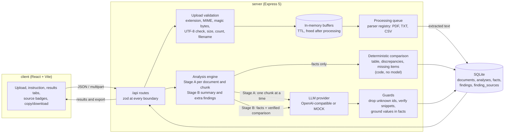

# Multi-Document Intelligence Workbench

Upload several documents (PDF, TXT, CSV), describe what you want to know, and get structured results: a comparison table, a consolidated summary, a discrepancy list, a missing-information report, and extracted key-value facts. Every finding cites the documents it came from, and the output keeps what the documents literally say (facts) apart from what the AI concludes from them (interpretation).

The workbench is a take-home build: React + Node.js in TypeScript, SQLite, and an LLM behind an OpenAI-compatible client. It runs fully offline with a built-in MOCK provider, so it works without an API key.

---

## Quick start

**Prerequisites:** Node.js 20 or newer (tested on Node 24.15) and npm 10 or newer.

```bash
npm install                     # on Windows without C++ build tools, see Troubleshooting
cp .env.example .env            # Windows: copy .env.example .env
npm run samples:generate        # regenerates samples/ (idempotent, output is committed)
npm run dev                     # API on http://localhost:4000, UI on http://localhost:5173
```

Open **http://localhost:5173**.

### Runs without an API key

`LLM_API_KEY` is empty in `.env.example`, so the app uses the **MOCK provider**. It is rule-based and deterministic. It reads the same prompts and returns the same schema-validated output as a real model, so the UI and the tests exercise the same contract. It finds labelled fields, CSV values, currency amounts, emails and dates. It does not understand prose, and it ignores the free-text instruction. Read the limitations section before judging result quality.

### Switch to a real LLM

Any OpenAI-compatible chat-completions endpoint works:

```bash
LLM_API_KEY=sk-...                      # any key your provider issues
LLM_BASE_URL=https://api.openai.com/v1  # or another compatible base URL
LLM_MODEL=gpt-4o-mini                   # or any model that supports JSON output
```

The real path (`openaiProvider.ts`) is covered by automated tests only through a fake transport. It was run by hand against OpenAI (`gpt-4o-mini`) on the sample set, and the results are in the [Demo](#demo-in-60-seconds). See [Known limitations](#known-limitations).

### Troubleshooting

- **`npm install` fails in `better-sqlite3` on Windows** (`gyp ERR! find VS`, "Could not find any Visual Studio installation"). The package ships a prebuilt `win32-x64` binary, but npm also runs `node-gyp rebuild` during install, which needs Visual Studio's C++ tools. Run `npm install --ignore-scripts` instead. This skips the native compile, and the shipped binary loads (verified on Node 24.15). To compile from source, install "Desktop development with C++" from Visual Studio Build Tools and run `npm install` again.
- **`tsx` or `vitest` not found** after a failed install. Run `npm install` (or `--ignore-scripts`) at the repository root, not inside a workspace.
- **Old database after a schema change.** Run `npm run db:reset`. There is no migration tool yet.

### Other commands

| Command | What it does |
|---|---|
| `npm test` | Runs the shared, server and client test suites (offline, no key needed) |
| `npm run test:server` / `test:client` / `test:shared` | One workspace at a time |
| `npm run check` | Typecheck every workspace (including test folders), then all tests |
| `npm run seed` | Loads the four valid samples into the database through the real upload and processing path. Re-running skips samples already loaded |
| `npm run db:reset` | Deletes the SQLite file. The schema is recreated on the next start |
| `npm run build` | Compiles `shared`, `server` and `client` |

The database defaults to `./data/app.db` (created on first start). Use `DB_PATH=:memory:` for an ephemeral run.

---

## Demo in 60 seconds

1. **Upload the valid set.** Drag these four files from `samples/` into the upload area:
   `application_form.pdf`, `supporting_letter.txt`, `financials_fy2025.csv`, `kyc_summary.txt`.
   Each one moves from *uploaded* to *processing* to *processed* while the page polls.
2. **Run the example instruction.** Click the example chip *"Highlight discrepancies in names, addresses, licence details, or revenue figures"* and press **Analyse**.
3. **Check the results against the answer key.** [samples/EXPECTED_FINDINGS.md](samples/EXPECTED_FINDINGS.md) lists every planted item. Expect:
   - **Discrepancies:** applicant name (Mehta vs Mehra), registered address (Sector 21 vs Sector 12), licence expiry (2027 vs 2026), and FY2025 revenue (three different figures, three sources).
   - **Not flagged:** the company name, "Pvt Ltd" vs "Private Limited", is treated as the same company.
   - **Missing information:** the co-director and the revenue figure are missing from the KYC summary.
   - **Source badges:** every finding shows one badge per supporting document. Hover a badge to see the quoted snippet. Click it to jump to that fact.
4. **Copy or download.** Use *Copy as Markdown*, *Copy JSON* or *Download .md*. All three come from the same server export.
5. **See graceful rejection.** Upload the files in [samples/invalid_samples/](samples/invalid_samples/): `fake.pdf` (renamed text), `empty.txt`, `script.exe` and `notes.docx`. Each is rejected with a reason and never executed. Uploading them together with a valid file accepts only the valid one. Rejected files are shown once in the alert and are not added to the document list.

The MOCK provider finds the four discrepancies and the missing items above. Three items need a real model to judge: the licence is probably already expired as of today, the revenue is described as "provisional", and the existing EMI affects the request. The MOCK does not assert those.

---

## Architecture



### How one analysis runs

1. **Resolve documents.** Only processed documents are used. Failed or unready documents are skipped with a warning. The request returns 409 only when no document is usable.
2. **Stage A, per document and per chunk.** Each document is split into chunks of about 4,000 characters with 200 characters of overlap. Each chunk goes to the model in its own prompt, and the model returns facts. Each fact carries a `documentId` and a verbatim `sourceSnippet` (at most 200 characters). Documents run in parallel (concurrency 3). A failing document or chunk becomes a warning, and the run continues.
3. **Deterministic comparison (code, no model).** The comparison table, the discrepancies and the missing-information items are computed from the facts, so none of them can contain a value that no document states. Fact keys are normalised through a synonym map (`applicant_name`, `director_name` and a bare `name` are one field; `annual_revenue_2025` and `revenue_fy2025` are one field), and values are normalised too (Indian digit grouping, `INR`/`Rs`/`₹`, "crore" and "lakh", date formats, "Pvt Ltd" = "Private Limited", case and spacing). Facts are grouped by normalised key across all documents:
   - the **table** has every document as a column;
   - a **discrepancy** lists *all* documents that state the field, each with its own value. A difference that is only formatting is not a discrepancy. A company name written two ways is a low-severity match;
   - **missing information** covers important fields (names, address, licence number and expiry, revenue, co-director) that some documents state and others do not. A statement such as "No revenue figure is recorded" counts as a gap, never as a value.
4. **Stage B, the model.** One prompt receives the structured facts grouped by `documentId` and the verified comparison. It never receives raw document text. The model writes the **summary** and may add **extra findings** relevant to the instruction. Its own table and missing-information items are ignored. Temperature is 0 on every model call.
5. **Guards, for any provider.** `validateProvenance` removes unknown document ids. `enforceFactOwnership` drops a fact id that belongs to a different document. Snippets missing from their document cap confidence at 0.3 and add a warning. **Value grounding** then checks every model discrepancy or comparison: each source must cite a fact of its own document, the cited values must really differ (or agree), and the wording is rebuilt from the facts' actual values. A finding that fails is dropped with a warning. A finding with no valid source is dropped.
6. **Persist in one transaction.** Facts, findings, sources, summary, table and warnings are saved together. A run that fails after Stage A keeps the facts already saved, and its status is `failed`.

### Data model

| Table | Holds | Notes |
|---|---|---|
| `documents` | Upload metadata, status (`uploaded`, `processing`, `processed`, `failed`, `unsupported`), extracted text, char count, truncation flag | Raw bytes are not stored. They live in memory until processing ends |
| `analyses` | One row per run: instruction, status, provider, summary, comparison table, warnings | |
| `analysis_documents` | Which documents a run covers | |
| `extracted_facts` | **Facts:** `documentId`, key, value, category, `sourceSnippet`, confidence | Per analysis and per document |
| `findings` | **Interpretation:** type, title, description, severity | Types: discrepancy, missing_information, summary_point, comparison, key_value |
| `finding_sources` | **Provenance:** one row per supporting document, with optional `fact_id` and snippet | A finding needs at least one row. The zod schema and the repository enforce this, not a SQL trigger |

### Why facts and findings are separate

They are different kinds of claim. A fact says what one document literally states. A finding is an AI conclusion drawn from several facts. Mixing them would let a guess look like a quote.

- **Data model:** separate tables, and separate zod types (`ExtractedFact` and `Finding`). `Finding.isInterpretation` is the literal `true`.
- **API:** `AnalysisResult` has separate fields: `perDocumentFacts` for facts and `findings`, `comparisonTable`, `summary`, `missingInformation` for interpretation.
- **UI:** facts are tagged *Fact* in a neutral style, and interpretation is tagged *AI* with an indigo accent. They sit in separate tabs.
- **Markdown export:** separate sections, so the copied text keeps the same split.

### How document boundaries and provenance are kept

- **No merged prompt.** The raw text of one chunk of one document goes into one prompt. Cross-document reasoning sees facts only.
- **Facts carry provenance.** Each fact has a `documentId` and a snippet quoted from its document. The guards check that the snippet appears in that document.
- **Findings cite documents.** Every finding carries one or more `sources` with a real `documentId`. The guards remove citations to unknown documents.
- **Truncation is visible.** A document longer than `MAX_CHARS_PER_DOCUMENT` (default 60,000) is cut and flagged. The warning appears in the UI and in the export.

### Folder structure

```
multi-doc-workbench/
├── client/                  # React + Vite UI (components, API client, hooks)
├── server/
│   ├── src/
│   │   ├── routes/          # /api/documents, /api/analyses, /api/limits, /api/health
│   │   ├── upload/          # file validation (pure functions)
│   │   ├── processing/      # parser registry (pdf, txt, csv), chunking, queue
│   │   ├── llm/             # provider interface, OpenAI-compatible and MOCK, prompts, guards
│   │   ├── analysis/        # two-stage engine, markdown/JSON formatters
│   │   ├── db/              # schema.sql, repositories (zod on read and write)
│   │   ├── storage/         # in-memory buffer store with TTL
│   │   ├── config/          # env.ts: zod-validated environment
│   │   └── middleware/      # error envelope, 404 for unknown API routes
│   └── test/                # end-to-end sample test, HTTP helpers, setup (offline)
├── shared/                  # zod schemas and TypeScript types used by client and server
├── samples/                 # synthetic documents, EXPECTED_FINDINGS.md, invalid_samples/
├── scripts/                 # generate-samples.ts, seed.ts (standalone ESM, typechecked separately)
├── docs/modules/            # one doc per build module (M01 to M10)
├── CLAUDE.md                # project memory: module plan, progress and decisions logs
└── .env.example             # every environment variable, with defaults
```

---

## Completed functionality

Legend: ✅ done and tested · ⚠️ partial, see note · ❌ not done

### Functional requirements

| # | Requirement | Status | Notes |
|---|---|---|---|
| 1 | Upload multiple documents | ✅ | Up to `MAX_FILES` (default 10) per request, `MAX_FILE_SIZE_MB` (default 10) per file. Drag-and-drop or picker |
| 2 | At least two formats (PDF, TXT, CSV) | ✅ | Three formats parsed. Images are accepted but not read (see 3) |
| 3 | Image OCR (optional) | ❌ | PNG and JPEG pass validation, then get status `unsupported`. No OCR library is included |
| 4 | Extract and ingest content per document | ✅ | PDF via `pdf-parse` (page count, empty or scanned PDFs fail with a clear message). TXT as strict UTF-8. CSV as labelled text (`Row n: column=value; ...`), capped at 500 rows with a warning |
| 5 | User-defined analysis prompt | ✅ | 5 to 2,000 characters, with example chips. The MOCK ignores the free text (see Known limitations) |
| 6 | Analyse documents independently and collectively | ✅ | Stage A is per document and per chunk. The comparison is cross-document and runs on facts only |
| 7 | Comparison table | ✅ | Built in code for two or more documents. Fields as rows, every document a column. Rows where documents disagree are marked |
| 8 | Consolidated summary | ✅ | Summary tab |
| 9 | Discrepancy list | ✅ | Computed from the facts. Every document that states the field is cited with its own value |
| 10 | Missing-information report | ✅ | Important fields only, reported as "missing from ...", citing the documents that state the field |
| 11 | Key-value extraction | ✅ | "Extracted facts" tab, grouped by document |
| 12 | Every finding cites its documents (provenance) | ✅ | Enforced by zod and the repository, and by server guards for any provider |
| 13 | Copy-output button | ✅ | Copy as Markdown, copy JSON, download `.md`. Falls back to a read-only text area if the clipboard is blocked |
| 14 | Graceful handling of unsupported, unreadable or invalid files | ✅ | A file that fails validation is rejected with a code and a reason, shown once, and is not added to the document list. A file that is accepted but cannot be read (corrupt PDF, image) is listed as `failed` or `unsupported` with a readable message. The rest of the batch continues |
| 15 | Synthetic sample documents only | ✅ | Fictional company, people and identifiers. See [samples/README.md](samples/README.md) |

### Engineering expectations

| Expectation | Status | Notes |
|---|---|---|
| TypeScript strict on both sides, no `any` | ✅ | `strict` in every workspace. No `any` in source or tests |
| zod at every boundary | ✅ | Env, HTTP bodies, query strings, route params, LLM output, and parsed records on read and write |
| Shared types, never duplicated | ✅ | `shared/` is the only definition of contracts |
| Frontend and backend separation | ✅ | The client talks only to `/api` and has no server imports |
| Modular pipeline, one parser per format | ✅ | Parser registry; adding a format means one file and one registry entry |
| Structured AI output validated by zod | ✅ | One repair retry on invalid output, then a typed error. Raw model text never reaches the UI |
| Facts separate from interpretation | ✅ | Data model, API, UI and export |
| File validation (type, size, count, name) | ✅ | See [Security considerations](#security-considerations) |
| Secure file handling | ✅ | Memory only, no disk writes, no execution |
| Proper error handling | ✅ | One error envelope. No stack traces or internal details to the client |
| Large content: chunking and truncation with a visible note | ✅ | Chunks and a per-document character cap. The warning is shown |
| Automated tests (vitest) | ✅ | 240 tests in 25 files, all offline. See [Testing](#testing) |
| Small, clear commits | ✅ | One commit per module, conventional messages (see the commit history) |
| Lint | ❌ | ESLint is not configured. `npm run check` is typecheck plus tests |

---

## Assumptions

- **Single user, one trust boundary.** There is no login, no roles and no tenants. Anyone who can reach the server can upload and read every document.
- **Documents are English text.** The samples and tests are English. Other languages are not tested.
- **Text-based PDFs only.** A scanned PDF has no text layer, so it fails clearly rather than being read.
- **Synchronous analysis is acceptable for the scope.** The analysis endpoint holds the request open for up to `ANALYSIS_TIMEOUT_MS` (default 120 s). The UI shows an estimated stage text, because the server reports no progress.
- **Uploaded bytes are short-lived.** They live in memory for `BUFFER_TTL_MINUTES` (default 60) and are freed after processing. Nothing is stored on disk.
- **Each analysis run is independent.** There is no history UI. The page shows the latest run. The API lists past runs.
- **The sample set is representative enough for a demo.** The MOCK's correctness is checked against the planted items, not against general documents.
- **The MOCK is a stand-in, not an evaluation.** Its output is for offline demos and tests. Quality claims about the real model need an evaluation on real data.

---

## Known limitations

**Processing and storage**
- **Uploaded bytes live in memory.** A server restart loses them. A document that was uploaded but not yet processed then shows `failed` with the message "upload it again".
- **The processing queue is in-process.** Jobs are lost on restart. A document left in `processing` after a crash stays there. There is no startup sweep.
- **Processing timeout cannot cancel CPU work.** The parse keeps running in the background, but the document is marked `failed` and its bytes are freed.
- **PDF layout is flattened.** Tables and columns can lose their order. Chunk offsets refer to the normalised, stored text.
- **Long documents are cut.** Text beyond `MAX_CHARS_PER_DOCUMENT` (default 60,000 characters) is dropped and flagged. CSV is capped at 500 rows.
- **Schema changes need `npm run db:reset`.** There is no migration tool.

**Analysis**
- **Analysis is one blocking request.** A crash mid-run leaves the analysis `running` with no recovery. The budget is cooperative: it stops new provider calls, but an in-flight call runs to its own 45 s timeout.
- **Chunks within a document run one after another.** Documents run in parallel, up to three at a time.
- **No token budget on the cross-document prompt.** A very large fact set could exceed the model's context window.
- **Repair retry resends the model's bad reply,** which may contain document text, so the prompt grows.

**Models and quality**
- **The MOCK is heuristic.** It finds labelled lines, CSV pairs, currency, email and ISO dates. It matches labels by a fixed list of filler words and aliases, not by meaning. It does not compare dates with today, does not read prose qualifiers ("provisional"), and does not follow the instruction text.
- **The comparison is only as good as the extraction and the synonym map.** Keys are matched through a fixed synonym map and token rules, not by meaning. A field named in an unusual way is compared only with documents that use the same key. The applicant, the director and a bare `name` are treated as one person field, and documents agree when their sets of names overlap. Missing-information checks cover only the important fields listed above.
- **The real OpenAI path is checked by hand, not by automated tests.** It was run against `gpt-4o-mini` on the sample set and produced the expected discrepancies. The automated suite uses a fake transport, so response shape, rate limits and cost are not covered by CI.
- **Provenance catches fabricated citations, not wrong judgements.** A snippet is checked against its document, but a conclusion that misreads the document can still pass.

**Scope**
- **No OCR**, so image uploads are accepted but not read.
- **No authentication, no authorisation, no rate limiting, no audit log.**
- **The UI has been exercised through automated tests and HTTP calls, not in a real browser.** Layout, focus, the hover popover and phone-width behaviour are unverified.
- **Dark mode follows the operating system.** There is no toggle.

---

## Security considerations

**Upload handling**
- **Three-layer type check.** Each file must match an allowed extension, a matching declared MIME type, and a content signature. PDF starts with `%PDF-`, PNG and JPEG have their magic bytes, and TXT and CSV are valid UTF-8 with no NUL bytes. A renamed or fake file is rejected even when its name and MIME type look right.
- **Size and count limits.** Enforced by multer (`MAX_FILE_SIZE_MB`, `MAX_FILES`). Exceeding them returns 413 for the whole request.
- **Filenames are never used as paths.** Multer keeps files in memory, so nothing is written to disk and there is no path traversal. The sanitised name is display data only (path segments removed, control characters and unsafe symbols dropped, length capped, no leading dot).
- **Nothing is executed.** Uploaded content is parsed as data. Files are never run, rendered as HTML or passed to a shell.
- **Partial success is explicit.** Each file gets its own accepted or rejected result, with a code and a reason.

**Input and output**
- **zod at every boundary.** Environment, request bodies, route parameters (UUIDs), query strings and LLM output are all parsed before use.
- **Safe errors.** One envelope (`{ error: { code, message } }`). Internal exceptions become a generic `INTERNAL_ERROR`. Stack traces, file contents and provider response bodies are not returned to the client.
- **Logs hold identifiers only.** The logger takes document ids, codes and counts. It never receives file contents or raw user text. The LLM client logs token counts and timings only.
- **Headers and CORS.** `helmet` sets security headers. CORS allows only `CLIENT_ORIGIN`. JSON bodies are capped at 1 MB.

**Prompt injection**
- **Uploaded text is untrusted data.** Document text is wrapped in `<document>` blocks, and facts in `<facts_json>`. Delimiter-like text inside a document is neutralised. Both system prompts tell the model to ignore instructions inside those blocks.
- **This is defence in depth, not a fix.** The guards that run after the model (citation checks, snippet checks, the fact-ownership check) still apply when the model is fooled. A test covers an injected "ignore previous instructions" sentence.

**Secrets and data**
- **No secrets in the repo.** `.env` is git-ignored. `.env.example` has an empty `LLM_API_KEY`. A scan of the tree found no keys or tokens.
- **Synthetic data only.** Every name, identifier and figure in `samples/` is invented. The identifiers are marked as fake.
- **Deletion is guarded.** A document used by a saved analysis cannot be deleted (409), so no finding loses its source.

---

## Productionisation

If this went to production, I would change these, in roughly this order:

1. **Storage.** Move uploads to object storage (S3 or similar) with short-lived signed URLs, and store only the object key in the database. Run a malware scan before parsing.
2. **Jobs.** Replace the in-process queue with BullMQ on Redis or SQS. Give each job retries, backoff and a dead-letter queue. Add a startup sweep for documents and analyses stuck in `processing` or `running`.
3. **Analysis as jobs.** `POST /api/analyses` returns a job id at once. Progress goes to the client over Server-Sent Events, with polling as the fallback. This removes the 120-second held request.
4. **Database.** Move from SQLite to Postgres, with real migrations (for example Drizzle or Prisma), connection pooling and backups.
5. **Auth and tenancy.** Add sign-in (OIDC or similar) and per-tenant row-level isolation on every table, including `finding_sources` and facts.
6. **OCR.** Send images and scanned PDFs to a managed OCR service (for example Amazon Textract), with confidence scores carried into facts.
7. **LLM operations.** Track cost, latency and token use per analysis. Use a model router or gateway for failover. Cache per-chunk extractions by content hash, since the same document often recurs.
8. **Evaluation.** Turn [samples/EXPECTED_FINDINGS.md](samples/EXPECTED_FINDINGS.md) into a regression suite that runs against the real model, and grow it with labelled real-world cases. Track precision and recall of discrepancies and missing items over time.
9. **Rate limits and quotas.** Per user and per IP at the edge, and per tenant on analysis runs.
10. **Delivery.** A CI pipeline (typecheck, tests, build, dependency and secret scanning). Containers, deployed to AWS ECS (or similar), with health checks and structured JSON logs shipped to a central service.
11. **Observability.** Request IDs through every log line, metrics for queue depth and processing time, and alerts on failure rates.

---

## Testing

`npm test` runs every suite offline. The server suite forces `LLM_API_KEY` empty and blocks `fetch`, so no test can reach a provider. Every HTTP test uses an in-memory SQLite database.

| Suite | Files | Tests | Covers |
|---|---|---|---|
| shared | 1 | 8 | Provenance at the contract level: findings need sources, facts need a `documentId` and a snippet |
| server | 22 | 230 | Upload validation (including invalid samples), parsers and their error states, chunking and truncation, buffer TTL, repositories, MOCK extraction and analysis, provenance and fact-ownership guards, key and value normalisation, the deterministic comparison, value grounding of model findings (including a model that swaps values between documents), OpenAI client with a fake transport (repair, retry, no retry on 400), prompt builders (no merged prompt, injection guard), analysis engine (partial failure, timeout, export), HTTP routes and error envelopes, config validation |
| client | 2 | 2 | Source badges and the AI tag on a finding card; the main flow in jsdom (upload, polling, example chip, analyse, copy, source click) |

**The flagship test** is [`server/test/analysis.samples.e2e.test.ts`](server/test/analysis.samples.e2e.test.ts). It uploads the four files in `samples/` in one multipart request, waits for processing, runs the analysis over HTTP, and exports markdown. It checks that:

- each document keeps its own facts, and every fact's snippet appears in its own document's text;
- the revenue discrepancy cites the application form and the supporting letter, and the name discrepancy (Mehta vs Mehra) exists;
- at least one missing-information finding exists;
- no finding cites an unknown document, and every finding has a source;
- the export contains `Source:` lines and every document name.

It matters because it runs the whole path the brief describes. Unit tests prove each guard on its own. This test shows that document boundaries and provenance still hold after upload, processing, analysis and export are connected.

Run `npm run check` for the typecheck and all tests. The last recorded run passed.

---

## AI tools disclosure and developer decisions

### Tools used

- **Claude Code** (Anthropic's coding agent) did most of the code generation, scaffolding, test writing and documentation. The models used across sessions are not recorded in `CLAUDE.md`. The final modules (M9 and M10) ran on Claude Haiku 5.5.
- **`CLAUDE.md`** was the persistent project memory. It holds the module plan, the progress and decisions logs, and the rules for each module, so every session started from the same facts.

### How AI was used

- The project was built one module at a time, from a written plan (M1 to M10). Each module had a goal, deliverables and acceptance criteria.
- Every module was checked before it was committed: typecheck, tests and, where possible, a live run over HTTP. Failures were fixed or recorded as known issues.
- I reviewed the generated code, ran it, and changed it where needed. Examples: the MOCK's matching rules and the provenance guards were corrected after tests showed gaps.
- AI did not write the requirements, choose the sample scenario, or decide what the product does. Those choices are marked in the decisions log below.

### Developer decisions

<!-- TODO(Sachin): review and edit this list so it reflects your own decisions honestly -->

Draft list, built only from the decisions log entries owned by the developer (`[Developer]`) in `CLAUDE.md`:

- **Project location and layout.** The project lives in its own repository, separate from unrelated projects (D8).
- **Two-stage analysis.** Per-document extraction first, then cross-document analysis on facts only (D36).
- **Partial failure.** A failing document or chunk becomes a warning and the run continues. The run fails only in the cases listed in D37 (D37).
- **Synchronous analysis API.** Chosen as a scope trade-off, with the cost recorded (D38).
- **Markdown export from the server.** One formatter for copy and download (D40).
- **Provenance UX.** Source badges per document, snippets on hover, and a click that jumps to the fact (D43).
- **Facts and AI interpretation shown distinctly.** Separate labels and styles, not colour alone (D44).
- **Polling over websockets.** Chosen for scope (D45).
- **Sample scenario.** A fictional loan case with planted discrepancies, consistent items and missing items (D49).
- **Sample PDF generated from a committed script.** Fixed metadata dates, so reruns are byte-identical (D50).
- **Acceptance target.** `EXPECTED_FINDINGS.md` is the target, and the tests assert the items the MOCK can judge (D55).
- **Flagship test.** The end-to-end test on the sample set is the single test to read first (D58).

AI-suggested decisions (`[AI-suggested]` in `CLAUDE.md`) have not yet been individually marked as accepted, changed or rejected. They are not listed above as the developer's own.

---

## Data

Every document in `samples/` is fictional and safe to share. No real personal or company data is in the repository.
